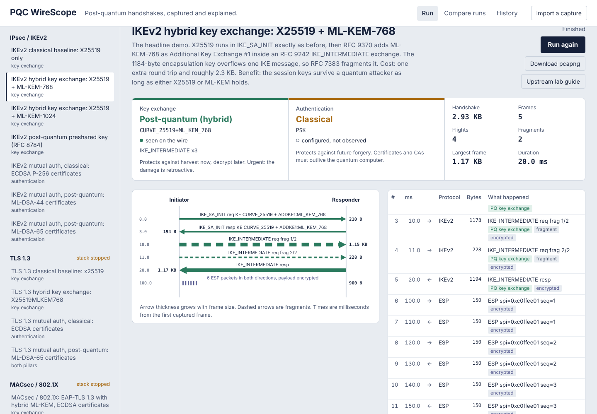
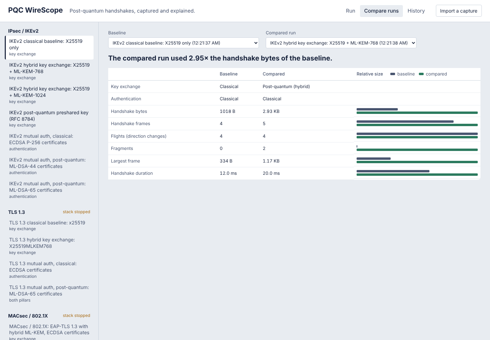

# PQC WireScope

**Watch post-quantum handshakes happen, packet by packet.**

PQC WireScope runs ML-KEM key exchange and ML-DSA authentication across
**IPsec/IKEv2, TLS 1.3, SSH and MACsec/802.1X** in Docker containers, captures
every packet end to end, and streams the capture live into a web UI:

- a **sequence diagram** whose arrows thicken with byte count, so a hybrid
  ML-KEM handshake visibly outweighs a classical one;
- a **decoded packet table** with a full dissection tree and hex for every frame;
- a **two-pillar verdict** (key exchange, authentication) that says whether each
  pillar was *seen on the wire*, only *reported by an endpoint*, or merely *declared*.



It builds on Julio Gomez's [juliogomez/pqc](https://github.com/juliogomez/pqc)
labs ("learn it in containers, deploy it on real gear") and the Cisco DevNet
live stream [*Post-Quantum Cryptography in the Real World* (Ep. 120)](https://www.youtube.com/live/9v_nuDHSd5I).
The upstream container images are built **unmodified**; this project adds the
automation, capture, analysis and visualisation layers.

> **Lab only.** Every key, certificate, PSK and PPK here is for throwaway containers.
> Never reuse any of it on a real network.

---

## Contents

- [Why this exists](#why-this-exists)
- [Measured results](#measured-results)
- [Scenarios](#scenarios)
- [Quick start](#quick-start)
- [How it works](#how-it-works)
- [Evidence levels](#evidence-levels-why-wire-matters)
- [Configuration](#configuration)
- [Security model](#security-model)
- [Observability](#observability)
- [Development](#development)
- [Troubleshooting](#troubleshooting)
- [Project status](#project-status)
- [Learn, then deploy](#learn-then-deploy)
- [Credits and licence](#credits-and-licence)

---

## Why this exists

"Post-quantum enabled" is easy to claim and hard to see. A vendor data sheet or
an endpoint log line says ML-KEM was negotiated; a packet capture **proves** it.
WireScope makes the proof the default view: every claim in the UI is backed by
bytes on the wire, and when the wire cannot show something (an encrypted
certificate, for example) the UI says so instead of guessing.

It is also a teaching tool. Running the classical and post-quantum variants of
the same handshake side by side answers the questions people actually ask:
*How much bigger is it? Does it add round trips? Does it fragment? Can it be
silently downgraded?*

---

## Measured results

Real runs on Docker Desktop (WSL2 kernel 6.18), strongSwan 6.0 (`ml` plugin) and
the strongSwan `ml-dsa` branch (6.1.0), captured inside the responder's network
namespace. Bytes are full Ethernet frame lengths of the handshake.

### IKEv2 key exchange

| Scenario | Frames | Handshake bytes | vs classical | Fragments | Verdict |
|---|---:|---:|---:|---:|---|
| Classical X25519 | 4 | 1,098 | 1.0x | 0 | classical (wire) |
| RFC 8784 PPK | 4 | 1,139 | 1.04x | 0 | pq-ppk (wire) |
| Hybrid X25519 + ML-KEM-768 | 7 | 3,735 | **3.4x** | 2 | pq-hybrid (wire) |
| Hybrid X25519 + ML-KEM-1024 | 8 | 4,742 | **4.3x** | 4 | pq-hybrid (wire) |

ML-KEM rides in an extra **IKE_INTERMEDIATE** round trip (RFC 9242 / RFC 9370):
the ML-KEM-768 public key (1,184 B) does not fit one frame, so the request is
split into two IKE fragments; the response (1,199 B frame) carries the ciphertext.

### IKEv2 authentication (all with hybrid ML-KEM-768 key exchange)

| Certificates | Frames | Handshake bytes | IKE_AUTH messages | Auth verdict |
|---|---:|---:|---:|---|
| ECDSA P-256 | 7 | 4,937 | 2 | classical (endpoint) |
| ML-DSA-44 | 17 | 17,949 | 12 (6 fragments each way) | pq ML-DSA-44 (endpoint) |
| ML-DSA-65 | 21 | 23,253 | 16 (8 fragments each way) | pq ML-DSA-65 (endpoint) |

For comparison, Cisco reports a C8000 on IOS XE 26.2 going from
*7 frames / 7 KB* (classical) to *20 frames / 24 KB* with ML-DSA-65 - the
container numbers land in the same place. Authentication is **endpoint**
evidence because IKE_AUTH is encrypted; see [evidence levels](#evidence-levels-why-wire-matters).

Every one of these runs also passed its data-plane check: three pings become six
ESP packets and no cleartext ICMP crosses the wire.

---

## Scenarios

18 declarative scenarios in [`scenarios/`](scenarios/), documented in
[docs/SCENARIOS.md](docs/SCENARIOS.md). Each one sets up a posture, starts the
capture, drives the handshake, pushes data through it, and checks assertions
against the capture.

| Stack | Scenario | Pillar | What it shows |
|---|---|---|---|
| `ipsec` | `ipsec-kex-classical` | key exchange | X25519-only baseline |
| | `ipsec-kex-hybrid-mlkem768` | key exchange | X25519 + ML-KEM-768 via IKE_INTERMEDIATE |
| | `ipsec-kex-hybrid-mlkem1024` | key exchange | X25519 + ML-KEM-1024, fragmented both ways |
| | `ipsec-kex-ppk` | key exchange | RFC 8784 post-quantum preshared key |
| `ipsec-auth` | `ipsec-auth-ecdsa` | authentication | ECDSA P-256 certificates |
| | `ipsec-auth-mldsa44` | authentication | ML-DSA-44 certificates |
| | `ipsec-auth-mldsa65` | authentication | ML-DSA-65 certificates |
| `tls` | `tls-kex-classical` | key exchange | x25519 baseline |
| | `tls-kex-hybrid` | key exchange | X25519MLKEM768 with no extra round trip |
| | `tls-auth-ecdsa-mtls` | authentication | ECDSA mutual TLS |
| | `tls-auth-mldsa65-mtls` | both | ML-DSA-65 mutual TLS, certificate algorithm read off the wire via a lab key log |
| `ssh` | `ssh-kex-default` | key exchange | `mlkem768x25519-sha256` is OpenSSH 10.4's default |
| | `ssh-kex-downgrade` | key exchange | forced classical KEX - and OpenSSH warns out loud |
| | `ssh-auth-composite` | both | composite Ed25519 + ML-DSA-44 host and user keys |
| `macsec` | `macsec-eaptls-ecdsa` | key exchange | EAP-TLS 1.3 with hybrid ML-KEM |
| | `macsec-eaptls-mldsa44` | both | ML-DSA-44 EAP certificates (about 3x the EAPOL frames) |
| | `macsec-downgrade-tls12` | key exchange | the **silent** downgrade to classical TLS 1.2 |
| | `macsec-downgrade-pinned-client` | key exchange | a client pin turns the downgrade into a loud failure |

**Compare** any two runs side by side (bytes, frames, flights, fragments,
duration), and **import** a pcap from a real router (IOS XE Embedded Packet
Capture) to analyse it with the same decoder.



---

## Quick start

### Requirements

| | |
|---|---|
| Docker | Engine with **Compose v2.20+** (`include:` support) |
| Disk | about 6 GB for images |
| Memory | 8 GB for Docker is comfortable; build stacks one at a time on less |
| Host tools | `git`, `bash`, `openssl`, `make` (optional - every target is a thin wrapper) |
| Kernel | XFRM for the IPsec ESP data plane; `CONFIG_MACSEC` only for the optional MACsec data plane |

### Run it

```bash
git clone --recurse-submodules https://github.com/natrajexplore/pqc_docker.git
cd pqc_docker
make bootstrap                 # upstream submodule + random lab secrets in .env
make preflight                 # what works on this host (XFRM, MACsec, free subnets)
make up PROFILES="ipsec"       # first build compiles strongSwan: 5-10 minutes
# open http://127.0.0.1:8080 and run a scenario
```

Add stacks as you need them: `make up PROFILES="ipsec ipsec-auth tls ssh macsec"`.
The management plane (UI, API, socket proxy) always runs.

### Without `make` (e.g. Windows + Git Bash)

```bash
./scripts/bootstrap.sh
./scripts/preflight.sh
docker network create --driver bridge --subnet 172.29.0.0/24 pqcw_mgmt
docker volume create pqcw_captures
docker compose --profile ipsec build ipsec-responder   # build images one at a time
docker compose --profile ipsec build cap-ipsec backend frontend
docker compose --profile ipsec up -d --no-build
```

### No Docker at all

`scripts/dev_mock_server.py` serves the real API and UI with a fake Docker and a
fake capture agent, so you can explore the interface and the analyzer anywhere:

```bash
cd frontend && npm install && npm run build && cd ..
pip install -e "backend[dev]"
cd scripts && python -m uvicorn dev_mock_server:app --port 8765
```

---

## How it works

```
 browser ──► frontend (nginx, 127.0.0.1:8080) ──► backend (FastAPI)
                                                    │  exec only, private network
                                                    ├──► socket-proxy ──► docker
                                                    │  HTTP + WS, X-PQCW-Token
                                                    └──► capture agent ─┐ shares the netns of
                                                                        ▼ one lab node
                 initiator ◄──── IKEv2 / TLS / SSH / EAPOL ────► responder
```

1. `POST /api/runs` starts a scenario; one run per stack at a time.
2. The orchestrator executes the scenario's steps with `docker exec` through a
   locked-down socket proxy (switch the swanctl variant, mint certificates, start
   daemons, wait for them).
3. A **capture agent** sidecar living in the responder's network namespace runs
   `dumpcap` (authoritative pcapng) and `tshark` (live EK JSON) on the lab interface.
4. Every packet is **normalized** - including by our own dependency-free IKEv2
   decoder, because distro dissectors still print new codepoints as "Unknown" - and
   pushed to the UI over a WebSocket as it arrives.
5. Cleanup steps always run; then metrics, assertions and the two-pillar verdict
   are computed and `run.json` is stored next to the pcapng.

Details in [docs/ARCHITECTURE.md](docs/ARCHITECTURE.md).

```
compose.yaml          root project: include: of every stack
stacks/<stack>/       compose file, protocol configs, credential scripts per profile
capture-agent/        sidecar: dumpcap -> pcapng, tshark -> live EK JSON
backend/app/          FastAPI: scenarios, orchestrator, docker exec, analyzer
backend/tests/        offline unit tests + golden pcap fixtures
scenarios/*.yaml      declarative runs: steps, capture filter, assertions
frontend/src/         React + Vite UI
scripts/              bootstrap, secrets, preflight, smoke, dev mock server
docs/                 architecture, plan, learning path, scenarios, wire reference
vendor/juliogomez-pqc upstream labs (git submodule, read-only)
```

---

## Evidence levels: why "wire" matters

| Level | Meaning | Example |
|---|---|---|
| **wire** | decoded from cleartext handshake bytes (or a lab key-log decryption) | ML-KEM-768 selected in the IKE_SA_INIT response |
| **endpoint** | reported by a peer's own tooling | `pki --print` says the installed certificate is ML-DSA-65 |
| **declared** | stated by the scenario file | fallback when nothing better exists |

The code never upgrades evidence. IKEv2 and TLS 1.3 encrypt certificates, so
their authentication verdicts are *endpoint* - unless a TLS scenario uses a
lab-only key log to decrypt the Certificate message, which makes it *wire*.

A capture inside the receiving peer also sees each decrypted ESP packet a second
time, re-injected by the kernel with the same timestamp. The analyzer tags those
frames `decap-copy` and keeps them out of "cleartext on the wire" checks, while a
real leak (no matching ESP frame) still fails.

---

## Configuration

All settings live in `.env` (created by `make secrets` / `make bootstrap`, gitignored,
mode 600). See [`.env.example`](.env.example).

| Variable | Default | Purpose |
|---|---|---|
| `PQCW_UI_PORT` | `8080` | UI port, published on `127.0.0.1` only |
| `PQCW_IKE_PSK`, `PQCW_IKE_PPK_HEX` | generated | IKEv2 PSK and RFC 8784 PPK |
| `PQCW_AGENT_TOKEN` | generated | backend <-> capture agent token; agents refuse to start without it |
| `PQCW_ALLOWED_HOSTS` | `127.0.0.1,localhost,::1` | host names the UI may be reached by (CSRF / DNS-rebinding guard) |
| `PQCW_LOG_LEVEL` | `INFO` | backend log level |
| `PQCW_LOG_FORMAT` | `text` | `text` or `json` (one object per line) |
| `PQCW_ALLOW_TLS_KEYLOG` | `true` | lab-only TLS key logs for wire evidence of TLS certificates |
| `PQCW_RUN_TIMEOUT_S` | `120` | hard limit for one scenario run |
| `PQCW_STRONGSWAN_MLDSA_REF` | `ml-dsa` | branch/tag of the experimental strongSwan ML-DSA build |

---

## Security model

WireScope demonstrates security protocols, so it tries not to be the weakest
thing on your laptop. Highlights (full model in [docs/SECURITY.md](docs/SECURITY.md)):

- UI on **loopback only**; backend and capture agents are not published at all.
- The API rejects requests with an unexpected `Host` or a cross-site `Origin`,
  so a web page you visit cannot drive it (CSRF, cross-site WebSocket, DNS rebinding).
- The backend never mounts the Docker socket. It talks to a **socket proxy**
  (pinned by digest) on a private internal network that lab containers cannot reach.
- Capture agents bind to the management network, require a random token compared
  in constant time, and fail closed without one.
- No `privileged` containers; `cap_drop: [ALL]` plus only the capabilities each
  role needs; `no-new-privileges`; read-only root filesystems for UI and API.
- Secrets are generated per checkout into `.env`; PKI is minted at run time into
  named volumes, never into the working tree.

Known gap, documented rather than hidden: the socket proxy still permits container
creation, so a compromised backend could escalate. Closing it needs a proxy with
per-method path allowlists.

---

## Observability

- **Request ids** end to end: nginx generates one, logs it as `rid=`, forwards it as
  `X-Request-ID`; the backend echoes it and stamps it on every log line - including
  the lines of the run that request started.
- **Run lifecycle** logged at INFO: start, step failures, finish with status,
  packet count and duration; pcap imports too.
- **Security events** logged: rejected Host/Origin (backend), bad agent tokens (agents).
- `PQCW_LOG_FORMAT=json` for Loki, ELK or any log shipper.
- **Healthchecks** on backend, frontend and capture agents (and lab nodes whose
  upstream image defines one): `docker compose ps`.

```bash
make logs                                    # backend + every capture agent
docker compose logs backend | grep <rid>     # everything one request did
```

---

## Development

```bash
make test        # backend pytest + frontend typecheck/build (no Docker needed)
make lint        # ruff, shellcheck, tsc
make smoke       # every available scenario through the real API
```

- **Tests**: analyzer, IKEv2 decoder, orchestrator (fake Docker), API guard, and
  golden fixtures - real captures in `backend/tests/fixtures/` replayed through
  tshark -> normalizer -> assertions -> verdict (skipped where tshark is absent).
- **Adding a scenario**: copy the closest file in `scenarios/` (file name = `id`),
  `POST /api/scenarios/reload`, run it, calibrate thresholds from the real capture
  and record what you saw in `expected_numbers`. See [CLAUDE.md](CLAUDE.md).
- **Building it with Claude Code**: the repo ships project commands -
  `/next-phase`, `/run-scenario <id>`, `/verify-wire <run_id>`, `/add-scenario <idea>` -
  that follow [docs/IMPLEMENTATION_PLAN.md](docs/IMPLEMENTATION_PLAN.md).

---

## Troubleshooting

| Symptom | Cause and fix |
|---|---|
| `preflight` says XFRM missing on Docker Desktop | older preflight probed with busybox `ip`; current probe installs iproute2. XFRM works on the WSL2 kernel. |
| `kernel MACsec NOT available` | normal on Docker Desktop. EAP-TLS handshake scenarios still work; only the 0x88e5 data plane needs it. |
| Build dies with `rpc error ... EOF`, Docker stops responding | memory pressure from parallel source builds. Restart Docker and build one image at a time; give WSL more memory in `%UserProfile%\.wslconfig`. |
| After such a crash a container fails with odd import errors | the build cache kept truncated (0-byte) files. Rebuild that image with `docker compose build --no-cache <service>`. |
| Upstream entrypoints fail with `bad interpreter` on Windows | files were checked out with CRLF. The repo's `.gitattributes` forces LF; for the submodule set `git -C vendor/juliogomez-pqc config core.autocrlf false` and re-checkout. |
| Capture agent exits immediately | `PQCW_AGENT_TOKEN` missing - run `make secrets` and restart the stack. |
| API answers `403 request rejected` | you reach the UI by a host name not in `PQCW_ALLOWED_HOSTS`; add it. |

---

## Project status

| Phase | State |
|---|---|
| Scaffold, analyzer, orchestrator, UI, offline tests | done |
| 1 - stacks up (mgmt + IPsec), socket proxy pinned, capture fields verified | done |
| 2 - IPsec key exchange and authentication on real containers | done: 7/7 scenarios pass, numbers recorded, golden fixtures added |
| 3 - calibrate TLS, SSH, MACsec | next |
| 4 - demo polish (presenter mode, ladder export) | planned |
| 5 - real Cisco gear (EPC import, C8000 compare) | optional |

Tracked in [docs/IMPLEMENTATION_PLAN.md](docs/IMPLEMENTATION_PLAN.md).

---

## Learn, then deploy

- [docs/LEARNING_PATH.md](docs/LEARNING_PATH.md) - four weeks from "what is ML-KEM" to a migration plan
- [docs/DEMO_SCRIPT.md](docs/DEMO_SCRIPT.md) - a 12-minute talk track that follows the UI
- [docs/DEPLOY_CISCO.md](docs/DEPLOY_CISCO.md) - mapping each scenario to IOS XE 26.2, importing router captures
- [docs/PQC_WIRE_REFERENCE.md](docs/PQC_WIRE_REFERENCE.md) - sizes and codepoints to look for in a capture
- [docs/SECURITY.md](docs/SECURITY.md) - the lab's own security model

---

## Credits and licence

Upstream labs, Dockerfiles and the learn/deploy structure: Julio Gomez,
[juliogomez/pqc](https://github.com/juliogomez/pqc) (MIT), pinned as a submodule.
Configuration files and credential scripts adapted from it say so in their
headers. See [NOTICE.md](NOTICE.md).

This project is released under the [MIT licence](LICENSE).
