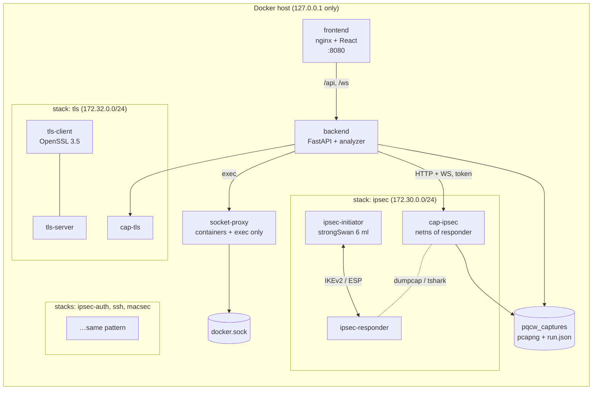

# Architecture

## The idea in one paragraph

Each protocol lab is a pair of containers from the upstream juliogomez/pqc repo
(initiator/responder, client/server, supplicant/authenticator). A **capture
agent** sidecar shares the network namespace of one node, so it sees exactly
what that node sees on the wire. The **backend** drives the nodes through a
locked-down Docker socket proxy (`docker exec`, nothing else), tells the agent
when to capture, decodes every packet as it streams in, and pushes it to the
**UI** over a WebSocket. When the run ends it checks assertions against the
capture and gives a verdict for each of the two PQC pillars.

## Components



| Component | Image | Job |
|---|---|---|
| `ipsec-*` | upstream `Dockerfile` (strongSwan 6.0.x, native `ml` plugin) | IKEv2 with X25519, ML-KEM-512/768/1024, PPK |
| `ipsec-auth-*` | upstream `Dockerfile.mldsa` (strongSwan `ml-dsa` branch) | IKEv2 certificate auth with ECDSA or ML-DSA |
| `tls-*` | upstream `Dockerfile.tls` (Debian trixie, OpenSSL 3.5) | TLS 1.3 with X25519MLKEM768, ML-DSA certs, mTLS |
| `ssh-*` | upstream `Dockerfile.ssh` (OpenSSH 10.4 from source) | mlkem768x25519-sha256 KEX, composite ML-DSA keys |
| `macsec-*` | upstream `Dockerfile.macsec` (hostap with EAP-TLS 1.3) | 802.1X EAP-TLS over a veth pair |
| `cap-*` | `capture-agent/` (Debian trixie, Wireshark 4.4) | pcapng + live EK JSON stream, API on mgmt leg |
| `backend` | `backend/` (FastAPI, tshark for offline work) | orchestrator, analyzer, REST + WS |
| `frontend` | `frontend/` (React build on nginx-unprivileged) | UI; proxies `/api` and `/ws` |
| `socket-proxy` | `tecnativa/docker-socket-proxy` | the only path to the Docker API |

## Networks

| Subnet | Network | Members |
|---|---|---|
| 172.29.0.0/24 | `pqcw_mgmt` (external, created by `make network`) | backend .10, frontend .11, socket-proxy .12, plus every node's second leg |
| 172.30.0.0/24 | `ipsec_net` | initiator .2, responder .3 |
| 172.31.0.0/24 | `ipsec_auth` | initiator .2, responder .3 |
| 172.32.0.0/24 | `tls_net` | server .2, client .3 |
| 172.33.0.0/24 | `ssh_net` | server .2, client .3 |
| 172.34.0.0/24 | `macsec_net` | placeholder; EAPOL rides the `aut`<->`sup` veth |

The subnets deliberately avoid the upstream labs' 172.20-172.25 range so both can
run side by side. Agents find their capture interface by subnet (`LAB_SUBNET`)
or by name (`CAPTURE_IFACE=aut` for MACsec), and bind their API to the address
they hold in `MGMT_SUBNET`, so the API is never reachable from a lab network.

## Sequence of a run

```mermaid
sequenceDiagram
  participant UI
  participant BE as backend
  participant SP as socket-proxy
  participant N as lab nodes
  participant A as capture agent
  UI->>BE: POST /api/runs {scenario_id}
  BE-->>UI: {run_id}; UI opens /ws/runs/{id}
  BE->>SP: exec setup steps (load variant, mint certs, start daemons)
  SP->>N: docker exec
  BE->>A: POST /captures {run_id, bpf}
  A-->>BE: capturing on eth1
  BE->>A: WS /captures/{id}/stream
  BE->>SP: exec handshake step (swanctl --initiate / s_client / ssh / wpa_supplicant)
  N-->>N: handshake on the lab network
  A-->>BE: packet (EK JSON) … packet
  BE-->>UI: packet (normalized, tagged) … live ladder grows
  BE->>A: POST /captures/{id}/stop
  BE->>SP: cleanup steps (always)
  BE->>BE: metrics -> assertions -> two-pillar verdict -> run.json
  BE-->>UI: run.result
```

## The analyzer

`backend/app/analyzer/`:

- **`ikev2.py`** decodes IKEv2 from the UDP payload itself rather than trusting
  the dissector, because the PQC codepoints are new: RFC 9370 Additional Key
  Exchange transforms (types 6-12), ML-KEM method IDs, RFC 9242 IKE_INTERMEDIATE,
  RFC 7383 SKF fragments and RFC 8784 PPK notifies. IKE_SA_INIT is decoded fully;
  everything after it is sized and labelled by its first inner payload.
- **`normalize.py`** turns each tshark EK document into a `NormalizedPacket`:
  protocol, direction (left/right endpoint by IP or MAC), a ladder label, and tags
  (`pq-kex`, `pq-kex-offer`, `classical-kex`, `downgrade`, `fragment`, `encrypted`).
- **`verdict.py`** computes metrics (handshake bytes, frames, flights, fragments,
  largest frame, duration, per-protocol summaries), evaluates assertions, and
  produces the verdict. Evidence strength is explicit: `wire` > `endpoint` > `declared`.
- **`deep.py`** runs tshark offline for the packet detail pane, pcap imports, and
  TLS 1.3 decryption with the lab key log (to read ML-DSA OIDs off the wire).

What each protocol exposes in cleartext decides what can be wire evidence:

| Protocol | Key exchange on the wire | Authentication on the wire |
|---|---|---|
| IKEv2 | yes - SA proposal + KE in IKE_SA_INIT | no - IKE_AUTH is encrypted (sizes only) |
| TLS 1.3 | yes - key_share in Client/ServerHello | only with the lab key log (Certificate is encrypted) |
| SSH | yes - both KEXINITs | server host key: yes (KEXINIT + KEX reply); user key: no |
| EAP-TLS | yes - same TLS hellos inside EAPOL | no (no key log path for hostap) - frame counts + endpoint |

## UI

Layout: scenario rail (grouped by protocol) | main column with the two-pillar
verdict strip, then the **ladder** beside the packet table, then step log and
packet detail.

The ladder is the one loud element: arrow stroke width is `sqrt(frame bytes)`,
so a classical handshake reads as hairlines and ML-KEM/ML-DSA messages visibly
thicken; fragments are dashed; runs of ESP/MACsec/app-data collapse into one row
("6 ESP packets in both directions, payload encrypted"). Colour means one thing
each: green post-quantum, amber classical, red downgrade, indigo encrypted data.
Everything else stays neutral.

Tokens live at the top of `frontend/src/styles.css` (light + dark). Fonts:
Atkinson Hyperlegible Next (UI) and Atkinson Hyperlegible Mono (byte counts, hex).

## Design decisions worth knowing

- **Sidecar agent instead of capturing on the host bridge.** Works identically on
  Docker Desktop (no host bridge access) and Linux, and the MACsec veth only exists
  inside the authenticator's netns.
- **dumpcap and tshark run side by side.** dumpcap writes the authoritative pcapng;
  tshark streams decoded fields. A dissector change can never corrupt the file.
- **Variant files instead of editing configs.** `swanctl --load-all --file
  variants/<v>.conf` swaps postures atomically and leaves the repo clean (upstream
  labs edit tracked files and `git restore` afterwards).
- **Named volumes for PKI.** Upstream bind-mounts `config/` and leaves private keys
  in the clone after `down`; here they live in volumes that `make nuke` removes.
- **One run per stack at a time.** Enforced by a per-stack lock; agents also refuse
  a second concurrent capture.
